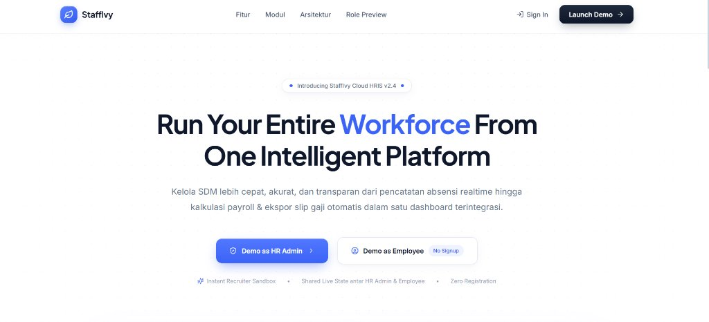
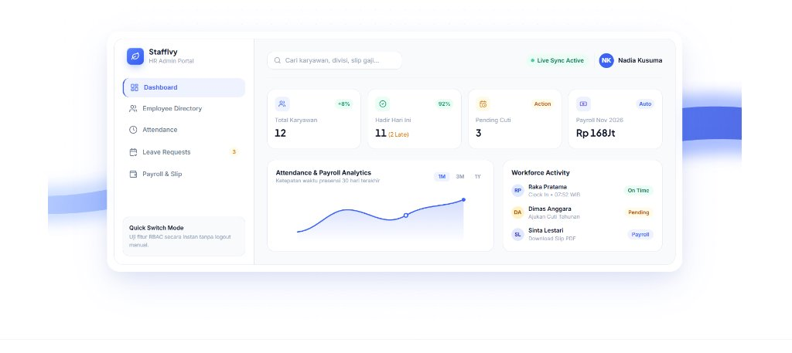
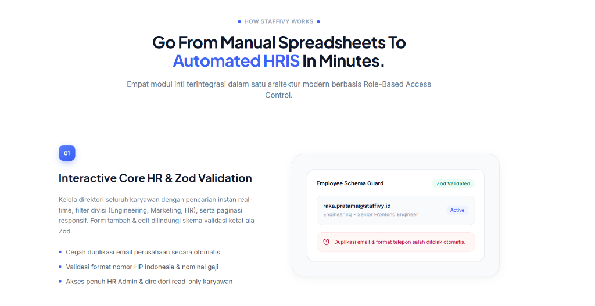
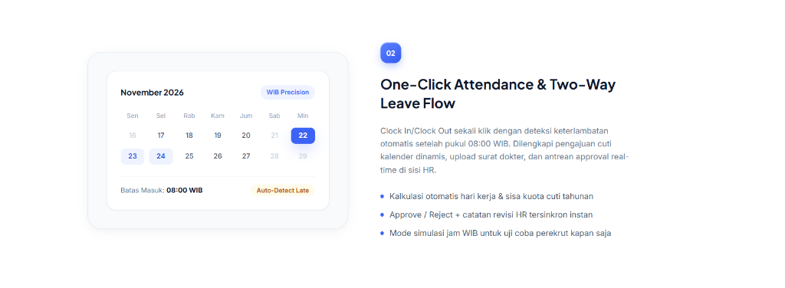
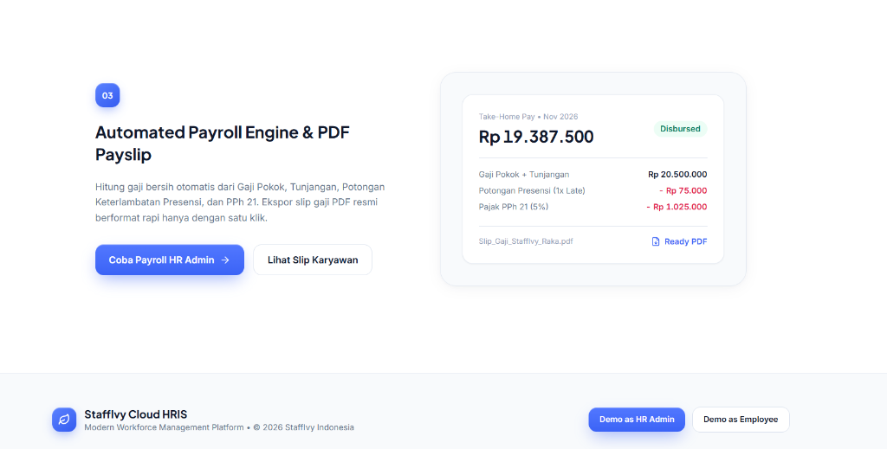

<div align="center">

# 🌿 StaffIvy — Modern Cloud-Based HRIS & Workforce Management

<p align="center">
  <strong>Platform SaaS Internal Perusahaan End-to-End untuk Otomatisasi Administrasi SDM, Absensi Real-Time WIB, Approval Cuti Dua Arah, dan Payroll Engine dengan Ekspor PDF Resmi.</strong>
</p>

[](https://nextjs.org/)
[](https://www.typescriptlang.org/)
[](https://tailwindcss.com/)
[](https://supabase.com/)
[](https://tanstack.com/table/v8)
[](https://recharts.org/)
[](https://zod.dev/)

</div>

---

## 📸 Tampilan Antarmuka Aplikasi (Screenshots)

### 1. Landing Page & Dual-Role Recruiter Sandbox
Halaman depan modern dengan akses uji coba sekali klik tanpa registrasi manual (*Zero Signup Sandbox*):


### 2. Interactive Workspace & HR Analytics Dashboard
Pratinjau modul operasional HR dengan ringkasan KPI, analitik ketepatan presensi Recharts, dan feed aktivitas real-time:


---

## 💡 Apa Itu StaffIvy?

**StaffIvy** adalah platform **Software-as-a-Service (SaaS)** internal perusahaan yang dirancang untuk menyederhanakan dan mengotomatisasi seluruh siklus tata kelola administrasi Sumber Daya Manusia (SDM / HR) secara menyeluruh (*end-to-end*). 

Dibangun dengan arsitektur **Role-Based Access Control (RBAC)**, StaffIvy menghubungkan dua peran kunci dalam operasional perusahaan:
1. **HR Administrator (Dewi Sartika / Nadia Kusuma)**: Mengelola direktori seluruh karyawan, memantau tren kehadiran harian perusahaan, memproses antrean persetujuan cuti (*Approval Queue*), mengontrol simulasi jam kerja, hingga menghitung dan menerbitkan slip gaji karyawan secara otomatis.
2. **Karyawan / Employee (Budi Santoso / Raka Pratama)**: Mengakses portal mandiri (*Self-Service Portal*) untuk pencatatan absensi harian presisi WIB, mengajukan cuti dengan upload berkas surat dokter, memeriksa sisa saldo kuota cuti tahunan, serta mengunduh berkas slip gaji resmi pribadi.

---

## 🛠️ Tech Stack & Arsitektur Modern

Proyek ini dibangun menggunakan standar rekayasa perangkat lunak enterprise modern:

| Kategori | Teknologi | Fungsi & Implementasi |
| :--- | :--- | :--- |
| **Framework Utama** | **Next.js 14 (App Router)** | Rendering hybrid (SSG, Client Components, Dynamic Code Splitting via `next/dynamic`) |
| **Bahasa Pemrograman** | **TypeScript 5.7** | *Strict type-safety* untuk seluruh entitas domain (Employee, Attendance, Leave, Payroll) |
| **Styling & Desain** | **Tailwind CSS v3.4** | Desain sistem ClinicOS SaaS dengan Google Fonts (*Plus Jakarta Sans* & *Inter*) |
| **Ikonografi** | **Lucide React** | Ikon visual konsisten dan ringan di seluruh antarmuka |
| **Tabel Data Interaktif** | **TanStack Table v8** | Tabel data karyawan dengan pencarian instan, filter divisi dinamis, dan paginasi |
| **Visualisasi Metrik** | **Recharts v2.15** | Grafik area spline interaktif untuk visualisasi tren kehadiran (*1W, 1M, 3M, 1Y*) |
| **Validasi & Manajemen Form** | **React Hook Form + Zod** | Form modal tervalidasi skema ketat (mencegah duplikasi email & nomor HP salah) |
| **Database & Cloud Storage** | **Supabase (PostgreSQL)** | Penyimpanan data relasional cloud terpusat & bucket upload berkas surat dokter |
| **Ekspor Dokumen PDF** | **jsPDF** | Pembuatan berkas slip gaji resmi instan di sisi klien lengkap dengan stempel digital |

---

## ✨ Fitur-Fitur Unggulan

### 1. Dual-Role Demo Switcher (Fitur Wajib untuk Recruiter)
- **Zero Registration Required**: Tombol akses cepat *"Demo as HR Admin"* dan *"Demo as Employee"* langsung di halaman depan.
- **Shared Live State**: Perubahan yang dilakukan di sisi karyawan (misal: absensi atau pengajuan cuti) langsung tersinkronisasi dan dapat dilihat/di-approve oleh HR Admin tanpa konflik state.

---

### 2. Interactive Core HR & Zod Schema Guard

- **Tabel Data TanStack Table**: Pencarian instan real-time (berdasarkan nama, ID karyawan, email, atau jabatan), filter per divisi (*Engineering, Marketing, HR*), dan kontrol paginasi.
- **Skema Validasi Zod**:
  - Pencegahan duplikasi email perusahaan di database.
  - Validasi regex format nomor telepon Indonesia (`08...` atau `+628...`).
  - Validasi batas minimal gaji pokok (Rp 3.000.000) dan tunjangan.
  - Proteksi akun demo utama agar tidak dapat terhapus secara tidak sengaja.

---

### 3. One-Click Attendance & Real-Time Log

- **Presisi Jam Server WIB**: Menampilkan jam digital real-time dengan akurasi zona waktu WIB (UTC+7).
- **Deteksi Keterlambatan Otomatis**: Sistem otomatis menandai status **"Late"** dan menghitung menit keterlambatan jika Clock In dilakukan lewat dari pukul **08:00 WIB**.
- **Recruiter Demo Clock Override**:
  - *Live WIB*: Mengikuti jam saat ini.
  - *Simulasi 07:45 WIB (On Time)*: Untuk menguji alur presensi tepat waktu.
  - *Simulasi 08:25 WIB (Late)*: Untuk menguji deteksi otomatis keterlambatan dan kalkulasi potongan denda payroll.

---

### 4. Two-Way Leave Approval Flow
- **Portal Karyawan**: 4 kartu saldo cuti tahunan (Kuota 12 hari, Terpakai, Menunggu Approval, Sisa Saldo Tersedia), pemilih rentang tanggal dengan kalkulasi otomatis hari kerja (mengecualikan Sabtu-Minggu), dan upload surat sakit dokter ke Supabase Storage.
- **Approval Queue HR**: Antrean pengajuan cuti berstatus *Pending* dengan aksi 1-klik (*Approve* / *Reject* + input catatan revisi) yang langsung memotong sisa saldo cuti karyawan secara *real-time*.

---

### 5. Automated Payroll Engine & Official PDF Exporter

- **Formula Transparan**:
  $$\text{Take-Home Pay} = (\text{Gaji Pokok} + \text{Tunjangan}) - (\text{Potongan Keterlambatan Presensi} + \text{PPh 21})$$
  - *Potongan Keterlambatan*: **Rp 75.000** per kehadiran status *Late*.
  - *Pajak Penghasilan*: **5% PPh 21**.
- **Ekspor Dokumen PDF Resmi**: Tombol *"Download Payslip (PDF)"* menghasilkan berkas PDF berformat formal lengkap dengan logo StaffIvy, header perusahaan, rincian komponen pendapatan & potongan, kalkulasi take-home pay, dan stempel digital persetujuan HR.

---

## 🗄️ Skema Database Supabase (PostgreSQL)

Proyek ini telah dilengkapi dengan skema PostgreSQL siap pakai di `supabase/schema.sql`:

```sql
-- 1. Tabel Karyawan
create table public.employees (
  id text primary key,
  name text not null,
  email text unique not null,
  phone text not null,
  division text not null,
  role text not null,
  base_salary numeric not null default 0,
  allowance numeric not null default 0,
  status text not null default 'Active',
  join_date date not null default current_date
);

-- 2. Tabel Absensi Harian
create table public.attendance_logs (
  id text primary key,
  employee_id text references public.employees(id) on delete cascade,
  date date not null,
  clock_in text not null,
  clock_out text,
  status text not null,
  late_minutes integer not null default 0
);

-- 3. Tabel Pengajuan Cuti
create table public.leave_requests (
  id text primary key,
  employee_id text references public.employees(id) on delete cascade,
  type text not null,
  start_date date not null,
  end_date date not null,
  days integer not null,
  reason text not null,
  attachment jsonb,
  status text not null default 'Pending',
  hr_note text default '',
  submitted_at timestamp with time zone default now()
);

-- 4. Tabel Log Aktivitas
create table public.activity_logs (
  id text primary key,
  actor text not null,
  action text not null,
  time text not null,
  badge text not null,
  tone text not null,
  created_at timestamp with time zone default now()
);
```

---

## 🚀 Panduan Instalasi Lokal (Getting Started)

### 1. Clone Repositori
```bash
git clone https://github.com/username-anda/staffivy-hris.git
cd staffivy-hris
```

### 2. Install Dependensi
```bash
npm install
```

### 3. Konfigurasi Environment Variable
Salin template konfigurasi atau buat berkas `.env.local`:
```env
NEXT_PUBLIC_SUPABASE_URL=https://your-project.supabase.co
NEXT_PUBLIC_SUPABASE_ANON_KEY=your-supabase-publishable-key
SUPABASE_SERVICE_ROLE_KEY=your-supabase-secret-key
```

> **Catatan Portofolio**: StaffIvy dilengkapi arsitektur *graceful fallback*. Jika variabel Supabase dikosongkan, aplikasi akan otomatis beralih ke *reactive mock data in-memory* sehingga demonstrasi live demo ke recruiter tidak akan pernah terhenti atau error.

### 4. Jalankan Server Development
```bash
npm run dev
```
Buka browser di [http://localhost:3000](http://localhost:3000).

### 5. Build untuk Production
```bash
npm run build
npm start
```

---

## 📁 Struktur Direktori Proyek

```
HRIS StaffIvy/
├── public/
│   ├── icon.svg                # Favicon vector SVG
│   └── screenshots/            # Berkas pratinjau gambar untuk dokumentasi GitHub
│       ├── hero-section.jpg
│       ├── dashboard-preview.jpg
│       ├── core-hr-directory.png
│       ├── attendance-leave.png
│       └── payroll-engine.png
├── src/
│   ├── app/
│   │   ├── apple-icon.tsx      # Dynamic Apple Touch Icon (180x180)
│   │   ├── icon.tsx            # Dynamic App Icon (32x32)
│   │   ├── globals.css         # Styling Tailwind & ClinicOS design tokens
│   │   ├── layout.tsx          # Root layout & modal dynamically imported
│   │   └── page.tsx            # Code-split app router (Landing vs Workspace)
│   ├── components/
│   │   ├── attendance/         # Modul Absensi WIB & Clock In/Out
│   │   ├── common/             # Toast notification provider
│   │   ├── dashboard/          # Modul Dashboard (KPIs, Recharts Spline, Activities)
│   │   ├── directory/          # Modul Employee Directory (TanStack Table v8)
│   │   ├── landing/            # Landing page (Hero, Ribbon Wave, Walkthrough)
│   │   ├── layout/             # Navbar, Sidebar, TopBar (WIB live clock)
│   │   ├── leave/              # Modul Pengajuan Cuti & Approval Queue HR
│   │   ├── modals/             # Modal Login, Karyawan (Zod), Slip PDF, Berkas
│   │   └── payroll/            # Modul Payroll Engine & Official PDF Exporter
│   ├── context/
│   │   └── hris-context.tsx    # State management reaktif, RBAC & sinkronisasi Supabase
│   ├── lib/
│   │   ├── mock-data.ts        # Dataset awal 12 karyawan Indonesia
│   │   ├── pdf-generator.ts    # Mesin pembuat berkas PDF resmi (jsPDF)
│   │   ├── schemas.ts          # Skema validasi formulir Zod
│   │   ├── supabase.ts         # Inisialisasi Supabase client & Storage upload
│   │   └── utils.ts            # Helper mata uang IDR, hari kerja, & jam WIB
│   └── types/
│       └── index.ts            # Definisi TypeScript domain models
├── supabase/
│   └── schema.sql              # Skema tabel PostgreSQL, RLS policies, & bucket setup
├── tailwind.config.ts          # Konfigurasi token Tailwind CSS
├── tsconfig.json               # Konfigurasi TypeScript
├── package.json
└── README.md
```

---

## 📄 Lisensi

Proyek ini dilisensikan di bawah lisensi **MIT License**. Terbuka untuk keperluan portofolio, referensi belajar, maupun pengembangan lebih lanjut.

